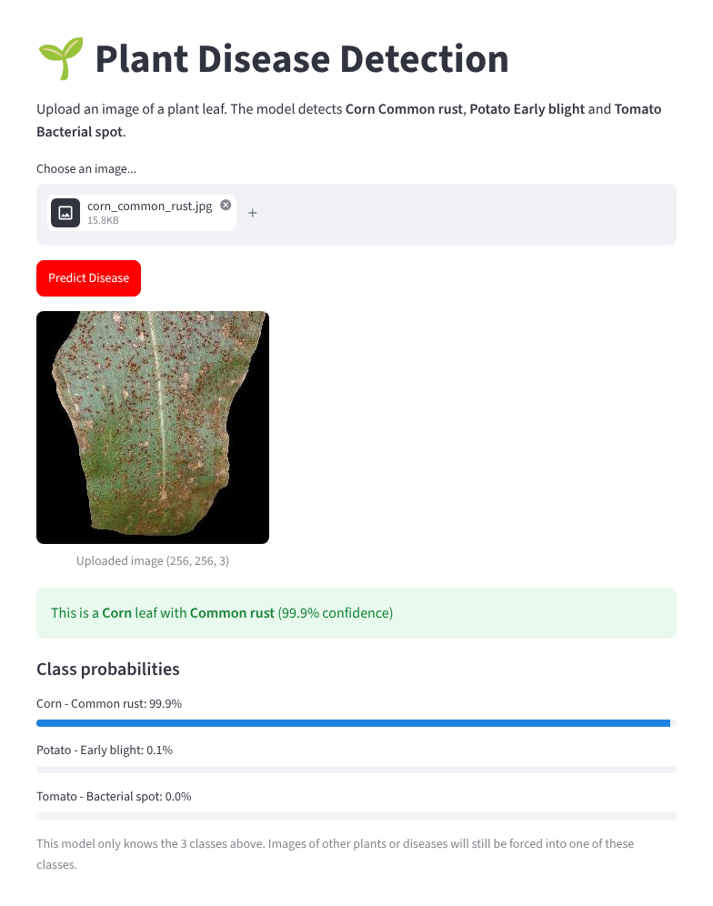
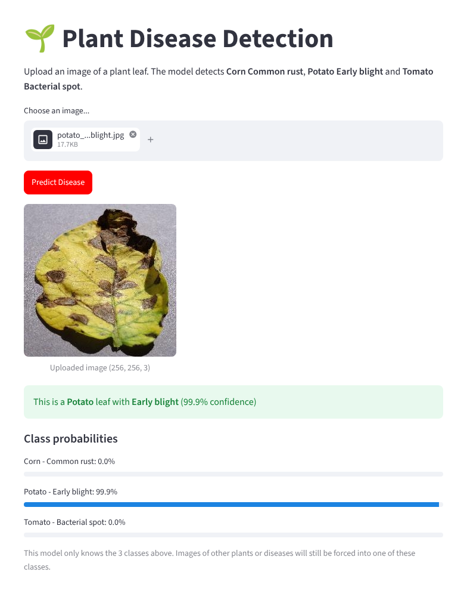
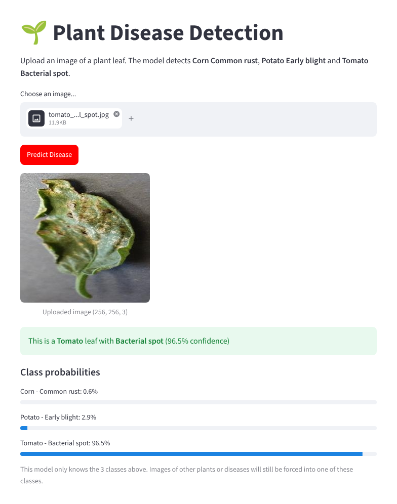
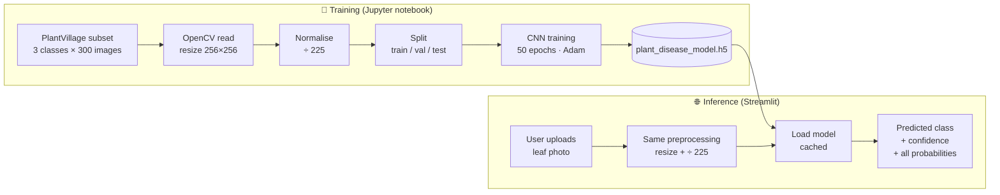

<div align="center">

# 🌱 Plant Disease Detection

### A convolutional neural network that identifies crop diseases from a single leaf photo, served through an interactive Streamlit web app




</div>

---

## 📌 Table of Contents
- [Overview](#-overview)
- [Demo](#-demo)
- [Dataset](#-dataset)
- [How It Works](#-how-it-works)
- [Model Architecture](#-model-architecture)
- [Results](#-results)
- [Getting Started](#-getting-started)
- [Project Structure](#-project-structure)
- [Bug Fix: Class-Label Mismatch](#-bug-fix-class-label-mismatch)
- [Limitations](#%EF%B8%8F-limitations)
- [Roadmap](#%EF%B8%8F-roadmap)

---

## 🔭 Overview

Crop diseases cause major yield losses, and early diagnosis often depends on an expert being on site. This project gives farmers and agronomists a **quick first check**: upload a photo of a leaf and a CNN classifies it in under a second.

The model recognises **3 crop–disease classes**:

| Crop | Disease | What it looks like |
|---|---|---|
| 🌽 **Corn (maize)** | Common rust | Small reddish-brown pustules scattered across the leaf |
| 🥔 **Potato** | Early blight | Dark brown lesions with concentric "target" rings, yellowing around them |
| 🍅 **Tomato** | Bacterial spot | Small dark, water-soaked spots that can merge and tear the leaf |

---

## 🎬 Demo

| Corn – Common rust | Potato – Early blight | Tomato – Bacterial spot |
|:---:|:---:|:---:|
|  |  |  |
| **99.9 %** confidence | **99.9 %** confidence | **96.5 %** confidence |

These are real outputs from the app using the sample images in [`test_images/`](test_images). The app shows the predicted class, its confidence, and the probability of every class.

---

## 🗂️ Dataset

### Source: **PlantVillage**, an open-access dataset of healthy and diseased leaf images

| Resource | Link |
|---|---|
| 📦 PlantVillage dataset (GitHub, official) | https://github.com/spMohanty/PlantVillage-Dataset |
| 📦 Mendeley Data mirror | https://data.mendeley.com/datasets/tywbtsjrjv/1 |
| 📄 Paper: Hughes & Salathé (2015) | https://arxiv.org/abs/1511.08060 |
| 📄 Paper: Mohanty, Hughes & Salathé (2016) | https://doi.org/10.3389/fpls.2016.01419 |

PlantVillage contains about **54,000 leaf images across 38 crop–disease classes**, photographed on plain backgrounds. It is the standard benchmark for leaf-disease classification.

### Subset used in this project

| Class folder (PlantVillage) | Images used | Label index |
|---|---:|:---:|
| `Corn_(maize)___Common_rust_` | 300 | 0 |
| `Potato___Early_blight` | 300 | 1 |
| `Tomato___Bacterial_spot` | 300 | 2 |
| **Total** | **900** (balanced) | |

**To reproduce:** download PlantVillage (color images), copy the three folders above into a local `Dataset/` directory, keep 300 images per class, and set `dataset_path` in the notebook.

---

## ⚙️ How It Works



**Data split:** 80 / 20 train/test, then 20 % of the training set held out for validation. That gives **576 train / 144 validation / 180 test** images.

**Training-serving parity:** the app applies exactly the same preprocessing as training: OpenCV BGR channel order, a 256×256 resize, and the same normalisation constant. If these differ, predictions silently degrade.

---

## 🧠 Model Architecture

A compact CNN built with Keras `Sequential`. It has **about 231k parameters**, so the model file is under 3 MB and runs fast on a CPU.

```
Input (256 × 256 × 3)
│
├─ Conv2D(32, 3×3, same, ReLU)        →  256 × 256 × 32
├─ MaxPooling2D(3×3)                  →   85 ×  85 × 32
├─ Conv2D(16, 3×3, same, ReLU)        →   85 ×  85 × 16
├─ MaxPooling2D(2×2)                  →   42 ×  42 × 16
├─ Flatten                            →  28,224
├─ Dense(8, ReLU)
└─ Dense(3, Softmax)                  →  P(Corn rust), P(Potato blight), P(Tomato spot)
```

| Setting | Value |
|---|---|
| Loss | Categorical cross-entropy |
| Optimiser | Adam (learning rate 1e-4) |
| Epochs / batch size | 50 / 128 |
| Labels | One-hot encoded |

---

## 📊 Results

| Split | Accuracy |
|---|---:|
| Training (final epoch) | 100 % |
| Validation (final epoch) | 99.3 % |
| **Test (180 unseen images)** | **99.4 %** |

Training and validation curves stay close together throughout, with no sign of overfitting on this subset. See [Limitations](#%EF%B8%8F-limitations) for why real-world accuracy will be lower.

---

## 🚀 Getting Started

### 1. Clone and install
```bash
git clone https://github.com/Bibishav26/Plant-Disease-Detection.git
cd Plant-Disease-Detection

python -m venv .venv
# Windows: .venv\Scripts\activate    |    macOS/Linux: source .venv/bin/activate
pip install -r requirements.txt
```

### 2. Run the web app
```bash
streamlit run main_app.py
```
Open **http://localhost:8501**, upload a leaf image (`.jpg`, `.jpeg` or `.png`), and click **Predict Disease**. You can try the samples in [`test_images/`](test_images).

### 3. Retrain the model (optional)
Open `Plant_Disease_Detection.ipynb`, point `dataset_path` to your local PlantVillage subset, and run all cells. The model is saved as `plant_disease_model.h5`.

---

## 📁 Project Structure

```
Plant-Disease-Detection/
├── main_app.py                     # Streamlit web app (inference)
├── Plant_Disease_Detection.ipynb   # Data loading, training and evaluation
├── plant_disease_model.h5          # Trained CNN (~2.8 MB)
├── requirements.txt                # Python dependencies
├── test_images/                    # One sample leaf per class
│   ├── corn_common_rust.jpg
│   ├── potato_early_blight.jpg
│   └── tomato_bacterial_spot.jpg
├── assets/                         # Screenshots for this README
├── LICENSE
└── README.md
```

---

## 🐞 Bug Fix: Class-Label Mismatch

The first version of the app showed **wrong disease names**. For example, a corn leaf with rust was reported as *"Tomato leaf with Bacterial_spot"*.

**Root cause:** during training, the labels came from `os.listdir()` on the dataset folders, which returned them in this order:

```python
0 → Corn_(maize)___Common_rust_
1 → Potato___Early_blight
2 → Tomato___Bacterial_spot
```

The app, however, hard-coded the class names in a **different order** (`Tomato, Potato, Corn`). The model's predictions were correct, but index 0 (Corn) was displayed as "Tomato" and index 2 (Tomato) as "Corn".

**Fix** (in `main_app.py`):
- Re-ordered `CLASS_NAMES` to match the training label indices, and documented why
- Applied the **same normalisation as training** (÷ 225) before prediction
- Fixed the typo *"Barly blight"* to **Early blight**
- Accepted `.jpeg` and `.png` as well as `.jpg`, and handled unreadable files gracefully
- Cached the model with `st.cache_resource` so it loads only once
- Added a **confidence score and per-class probability bars**

**Lesson:** never hard-code class order separately from training. Save the label mapping alongside the model and load it in the app.

---

## ⚠️ Limitations

- **Only 3 classes.** Any other plant or disease, including healthy leaves, will still be forced into one of the three. The app warns users about this.
- **Lab-style images.** PlantVillage photos have clean, uniform backgrounds. Field photos with soil, hands or other leaves will likely be less accurate.
- **Optimistic test score.** PlantVillage includes several photos of the same physical leaf, and a random split can put near-duplicates in both train and test sets.
- **Small subset.** 300 images per class is enough for a proof of concept, not for production use.
- **Normalisation constant.** Training divided pixels by **225** instead of the usual 255. The app uses 225 to stay consistent with the trained model; a retrain should use 255 in both places.

---

## 🗺️ Roadmap

- [ ] Add a **"Healthy"** class for each crop and expand to all 38 PlantVillage classes
- [ ] **Transfer learning** (MobileNetV2 / EfficientNet) for better accuracy on field photos
- [ ] Data augmentation (rotation, flips, brightness, background changes)
- [ ] Leaf-grouped train/test split to remove near-duplicate leakage
- [ ] Save the label map (`labels.json`) alongside the model
- [ ] Grad-CAM heatmaps to show *where* the model sees the disease
- [ ] Deploy publicly on **Streamlit Community Cloud** or Hugging Face Spaces

---

## 🙏 Acknowledgements

Leaf images from the **PlantVillage** dataset:

- D. P. Hughes, M. Salathé, *"An open access repository of images on plant health to enable the development of mobile disease diagnostics,"* arXiv:1511.08060, 2015.
- S. P. Mohanty, D. P. Hughes, M. Salathé, *"Using Deep Learning for Image-Based Plant Disease Detection,"* Frontiers in Plant Science 7:1419, 2016.

## 📄 License

Released under the [MIT License](LICENSE).

<div align="center">

⭐ If you find this project useful, consider giving it a star!

</div>
